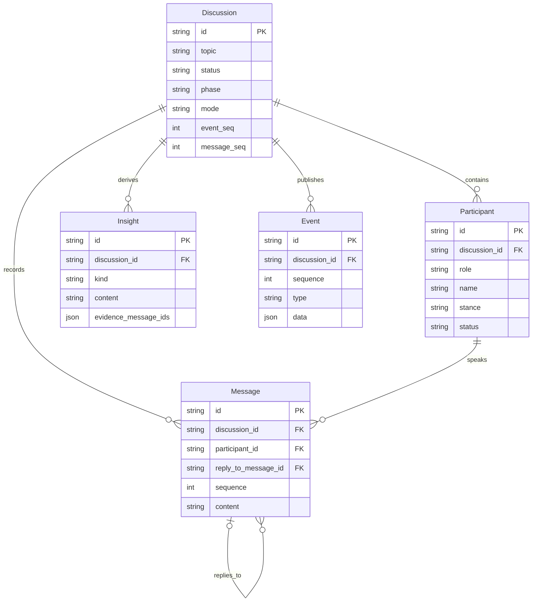
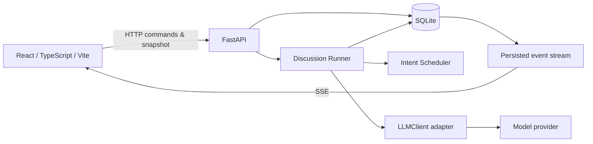

# 技术方案

状态：MVP 已实现，2026-11-17 更新。下文保留设计脉络，接口的最终格式见 `api.md`。核心实现位于 `backend/app`，前端组件位于 `frontend/src/components`。

## 实际落地与原方案差异

- 前端使用 React + TypeScript + Vite + Zustand + Lucide + 原生 CSS，没有引入 Tailwind/shadcn。Home、Roster、Studio、Avatar 分开维护。
- 后端路由集中在 `main.py`；短事务、事件追加与快照在 `database.py`，纯调度/证据规则在 `services/scheduler.py`，异步任务在 `services/runner.py`。
- 持久化使用 SQLAlchemy + SQLite，外键与 busy timeout 已启用；本地单进程 RLock 协调短事务，未开启 WAL，未支持多 worker。
- SSE 用 StreamingResponse 输出标准事件帧，250ms 查询持久化事件，约 10 秒心跳。命名类型放 JSON 的 type 字段，通过浏览器 onmessage 统一处理。
- 过程上下文保留最近 12 条消息、每位专家较早发言的最后一条截取，以及有效观点；没有额外模型摘要任务，避免摘要产生新事实及额外延迟。
- 真实模型仅接 DeepSeek，默认 deepseek-v4-pro，JSON 模式开启、thinking 关闭、max_tokens=4096；同接口可改为 deepseek-flash。官方参数已核对，实际 Key 请求尚未验收。
- 源代码与依赖已锁定，测试记录见 `verification.md`；用户人工验收仍待进行。

## 实际 ER 图



消息与事件的 `(discussion_id, sequence)` 各自有唯一约束。Insight 的消息引用存为 JSON，并在服务层校验归属与至少两位专家，未建立独立多对多关联表。

## 1. 架构与选型



前端使用原生 CSS、Lucide 与 Zustand。后端使用 Pydantic 校验、SQLAlchemy 管理持久化。初版单后端进程，单讨论单任务，不引入 Redis/Celery。

LLMClient 独立封装 DeepSeek Chat Completions 请求，使用 JSON object 模式与应用层 schema 校验，不假定 JSON 模式能够保证业务语义。模板默认 DeepSeek 官方地址；模型与参数可通过后端配置修改。

开发使用真实模式与 deterministic demo/fake 模式。真实模式失败应显式报错，不自动悄悄降级成演示模式。

## 2. 建议目录

```text
backend/
  app/
    main.py                 # 生命周期、路由挂载
    config.py               # 后端环境变量
    database.py             # 会话与初始化
    models.py               # SQLAlchemy 数据表
    schemas.py              # 请求、响应、事件与模型输出
    api/discussions.py
    services/runner.py      # 任务与状态机
    services/scheduler.py   # 无 I/O 的调度规则
    services/insights.py
    services/events.py
    llm/base.py
    llm/provider.py
    llm/demo.py
    prompts/                # 产品运行时 Prompt，单独版本管理
    seed.py
  tests/
  requirements.txt
frontend/
  src/
    components/
    pages/
    lib/api.ts
    lib/events.ts
    store/
    types/
  tests/e2e/
  package.json
docs/
scripts/
```

目录可按实际复杂度合并，避免为目录结构本身增加抽象。

## 3. 数据模型

所有子记录必须关联 discussion_id。ID 使用 UUID，时间使用 UTC，API 统一 ISO 8601。Transcript 的顺序与事件顺序各自有独立单调序号。

| 实体 | 关键字段与约束 |
| --- | --- |
| Discussion | id, topic, expert_count, status, phase, mode, summary, error_code, created_at, updated_at |
| Participant | id, discussion_id, role(host/expert), name, profession, title, stance, color, status, public_focus |
| Message | id, discussion_id, participant_id, sequence, content, reply_to_message_id, created_at；(discussion_id, sequence) 唯一 |
| Insight | id, discussion_id, kind(consensus/disagreement), content, evidence_message_ids, updated_at |
| Event | id, discussion_id, sequence, type, payload, created_at；(discussion_id, sequence) 唯一 |

事件 payload 和 evidence_message_ids 可用 JSON 存储。应用层验证全部引用确实属于同一讨论；不得只验证 ID 是否存在。

写入消息/观点、更新讨论状态、追加对应事件在同一短事务中完成，提交后再通知订阅者。模型网络请求必须位于数据库事务之外。SQLite 配置外键与合理 busy timeout；并发写入由短事务/单进程写入协调控制，WAL 是否开启在依赖版本确认后决定。

## 4. 状态机与运行生命周期

讨论状态：`generating → ready → running → completed`，异常进入 `failed`；进程重启遗留的 generating/running 进入 `interrupted`。

运行阶段：`opening → discussion → synthesis → closing`。专家状态：`idle / preparing / speaking`。

- POST 创建先生成讨论记录，再运行阵容生成任务；生成成功进入 ready。
- 用户确认才允许从 ready 进入 running。使用原子状态检查及任务注册防止重复启动。
- 任务注册表按 discussion_id 索引，强引用任务并处理异常，服务退出时取消并落状态。
- SSE 连接仅订阅，不创建 Runner；关闭页面不取消正在运行的讨论。
- 多讨论可以异步并行，使用全局模型请求信号量控制限流；禁止在某场讨论等待模型时持有全局业务锁。
- MVP 中断后保留已生成内容，可基于相同话题新建讨论；不承诺从半轮继续。

## 5. 讨论调度

每个调度周期：

1. 读取角色设定、当前议题、最近若干消息、滚动摘要和已有观点。
2. 各专家独立评估意图，可并发调用；不向专家提示强制轮流次序。
3. 校验意图，过滤无效目标、等待意图与不合法字段。
4. 调度器综合直接回应、紧迫度、等待时长、连续发言限制选人。
5. 只让胜出专家生成完整发言，校验后持久化、推送。
6. 增量更新公开关注点和共识/分歧；必要时主持人串联或追问。
7. 根据发言数、周期数、总耗时与调用预算决定继续或进入总结。

意图 schema：`action: wait|raise|supplement|rebut`、`target_message_id: optional`、`urgency: 0..1`、`public_focus: short string`。不要求或存储隐藏推理过程。

公平性：限制连续发言，等待时间只在参与申请时累计，不把所有沉默专家强制轮询。无人申请时主持人定向提问或结束当前分支。某个专家意图超时可跳过该专家；全部失败则进入有界重试/失败状态，不能无限主持人自言自语。

上下文仅保留有限近期消息与滚动摘要，所有上下文按 discussion_id 构建。用户话题与 transcript 被视为待分析内容，不能覆盖系统角色和输出契约。

## 6. 共识与分歧

每 1–2 条专家发言触发增量提炼，间隔可配置；不能仅在结束时生成。以现有观点和新增发言为输入进行更新与去重。

每项必须返回 evidence_message_ids；共识至少需要多位专家的明确支持证据，分歧需要能展示不同意见的证据。后端验证消息来源与参与者，缺乏证据的观点丢弃或标为未确认，不擅自推断全员一致。

最终总结由主持人基于实际 transcript 与已验证观点生成自然语言，可包含已达成共识、未解决分歧和后续验证建议。

## 7. HTTP API 契约

统一前缀 `/api`；错误体为 `{code, message, retryable}`，不返回密钥、完整供应商请求或内部堆栈。

| 方法与路径 | 请求/行为 | 响应 |
| --- | --- | --- |
| GET /health | 本地健康检查 | 服务状态与 mode，不含密钥 |
| GET /discussions | 列表，支持 limit/cursor | 列表摘要、分页信息 |
| POST /discussions | `{topic, expert_count}` | 202 + discussion_id、generating 状态 |
| GET /discussions/{id} | 获取一致快照 | 讨论、嘉宾、消息、观点、last_event_sequence |
| POST /discussions/{id}/start | 确认 ready 阵容 | 202；重复 running 请求返回当前状态，不再启动 |
| GET /discussions/{id}/events | `after` 游标或 Last-Event-ID | 按序 SSE 事件流 |
| POST /discussions/{id}/retry-generation | 仅阵容生成失败且无消息时 | 202；重新生成同一讨论的阵容 |

找不到返回 404，输入错误 422，非法状态转换 409。重开已经中断的演播流程通过新建讨论实现，避免含混的重试语义。

## 8. SSE 契约与恢复

事件类型：`roster.ready`、`participant.updated`、`message.created`、`insights.updated` 和 `discussion.{generating|running|completed|failed|interrupted}`。

事件统一字段：`discussion_id, sequence, type, data, created_at`。SSE 的 id 使用讨论内 sequence，前端按 `(discussion_id, sequence)` 去重。

初次进入先读取一致快照，再订阅 `after=last_event_sequence`。快照之后、订阅之前产生的事件从数据库补发，不丢失。重连时 Last-Event-ID 优先于初始 after 参数。

服务端按游标持续读取持久化事件，可用通知优化延迟但不能仅依赖易丢失的内存通知。定期发送心跳注释。讨论终止且事件消费完成后前端主动关闭连接，避免自动重连循环。

只持久化完成的语义事件。首版可按完整的 1–2 句发言推送，不强制 token 流式；页面始终展示真实等待/准备状态。

## 9. 配置与运行约定

拟定配置：`APP_MODE=demo|live`、`DATABASE_URL`、`LLM_API_KEY`、`LLM_BASE_URL`、`LLM_MODEL`、请求超时、最大并发、讨论预算。具体变量以实现后的 `.env.example` 为准。

真实密钥只在后端，前端不使用 VITE_* 储存密钥。开发用 Vite `/api` 代理，生产式本地运行可由 FastAPI 托管前端构建产物。后端绑定 loopback，开发 CORS 仅允许实际本地前端源。

默认演示模式无外部请求、行为确定、显式标识。生产式本地模式也保留真实/演示标识；没有密钥的 live 模式启动即报配置错误。

## 10. 测试策略

- pytest：嘉宾字段与数量、调度优先级/公平性/全等待、终止预算、状态转换、重复启动、无效输出、超时、观点证据与讨论隔离。
- API/服务集成：临时 SQLite、两个讨论同时运行、事件顺序与游标补发、快照一致性、错误事件可见。
- Playwright：首页创建→阵容确认→演播厅→观点更新→总结；加入已有讨论；刷新；双讨论隔离；桌面/小屏核心操作。
- 测试通过注入后端 FakeLLM 保证可重复，不能只 mock 浏览器 API 而绕过真实后端。
- 至少一次真实模型完整验收单独记录模型名、耗时、结果；无可用配置时明确标注未执行。

参考资料（首次规划时查阅）：[Vite](https://vite.dev/guide/)、[FastAPI SSE](https://fastapi.tiangolo.com/tutorial/server-sent-events/)、[SQLite 隔离](https://www.sqlite.org/isolation.html)、[Playwright](https://playwright.dev/docs/intro)。实际安装时核对版本，不能直接假设文档中的新 API 已在本地安装。
